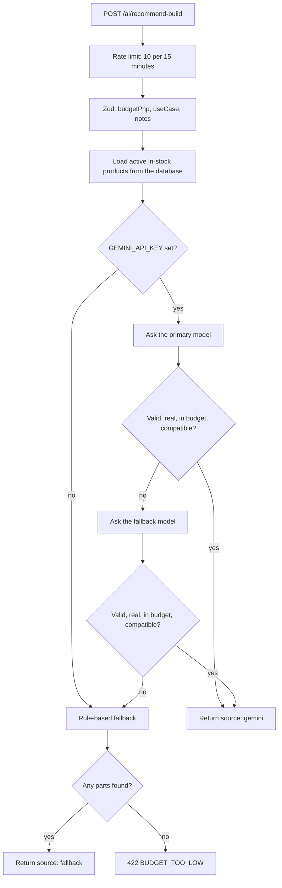

# AI Integration

`POST /api/v1/ai/recommend-build` turns a budget and a use case into a list of real store products. It calls Google Gemini, then checks everything the model says against the database before the customer sees it. If Gemini is down, slow or returns something we reject, a rule-based builder answers instead, so the feature never just fails.

## How a request flows

## Request and response

Request body, checked by `validators/ai.validators.js`:

| Field | Rule |
|---|---|
| `budgetPhp` | Whole number, 1,000 to 1,000,000 |
| `useCase` | `gaming`, `editing` or `office` |
| `notes` | Optional text, up to 1,000 characters |

Response (inside the usual `{ success, data }` envelope):

| Field | Meaning |
|---|---|
| `source` | `gemini` or `fallback` |
| `model` | The Gemini model that answered, or `null` for the fallback |
| `summary` | Short explanation text |
| `items[]` | `{ id, name, category, priceCentavos, reason }` for each part |
| `totalCentavos` | Sum of the item prices |
| `budgetCentavos` | The budget converted to centavos |
| `notes` | Messages such as "No graphics card fits what is left of the budget." Empty for Gemini builds. |

Errors: 422 `VALIDATION_ERROR` for bad input, 422 `BUDGET_TOO_LOW` when not even the fallback can build a compatible set (the reasons are in `details`), and 429 `RATE_LIMITED`.

## Grounded in the database

`repositories/ai.repository.js` runs one query per request: products that are `is_active = true` and `stock > 0`, joined to their category. That list is the only catalog the model is shown (`id`, `name`, `category`, `pricePhp`, `specs`). Out-of-stock and deactivated products are never offered.

The model is told to use only ids from that catalog. Whatever it returns is then looked up by id in the same list, so **names, categories and prices in the response come from the database, not from the model**. The model only supplies the choice of products, a `reason` for each, and the `summary`.

A recommendation does not reserve stock. Stock can change before the customer buys, and the normal cart and checkout checks still apply.

## Calling Gemini

`callGemini` in `services/ai.service.js` uses plain `fetch`, with no SDK:

- Endpoint: `https://generativelanguage.googleapis.com/v1beta/models/{model}:generateContent`.
- The API key goes in the `x-goog-api-key` header, from `GEMINI_API_KEY`. It lives only on the server and is never sent to the browser.
- A system instruction holds the rules. The user message is one JSON object with `request` and `catalog`.
- `responseMimeType: application/json` and `temperature: 0.2`, to get steady, machine-readable output.
- An `AbortController` cancels the call after `GEMINI_TIMEOUT_MS`.
- Any "thought" parts in the reply are ignored, and only the text is used.

Two models are tried in order: `GEMINI_MODEL`, then `GEMINI_FALLBACK_MODEL`. If both names are the same, only one call is made. Any failure on a model (HTTP error, timeout, bad output) is logged on the server as `AI model <name> was not used: <reason>` and the next model is tried. The customer never sees the raw error. Because each model can use the full timeout, the worst case before the fallback answers is about twice `GEMINI_TIMEOUT_MS`.

## Validating the output

`parseAndCheck` accepts the model's answer only if every step passes. Any failure rejects that model's answer:

| Check | Rejection reason |
|---|---|
| Output is valid JSON (a Markdown code fence around it is stripped first) | `invalid_json` |
| Output matches the Zod schema: `summary` 1 to 600 characters, `items` 1 to 12 entries, each with `productId` (1 to 64) and `reason` (1 to 300) | `schema_mismatch` |
| Every `productId` exists in the loaded catalog | `unknown_product_id` |
| No product appears twice | `duplicate_product` |
| Total price (from database prices) is within the budget | `over_budget` |
| `checkCompatibility` finds no issues | `incompatible: <codes>` |

The compatibility check is the same function behind `POST /compatibility/check` (`services/compatibility.service.js`), so an AI build and a manual build are judged by the same rules. Its issue codes are `SOCKET_MISMATCH`, `RAM_TYPE_MISMATCH` and `PSU_INSUFFICIENT`.

## Prompt-injection resistance

The free-text `notes` field is the attack surface, because a customer types it and it reaches the model. Several layers limit the damage:

1. **Treated as data.** `notes` travels as a string value inside a JSON object, never mixed into the instructions. The system instruction says it is untrusted text, to be treated only as a preference, and never to be obeyed, revealed or allowed to change the output format.
2. **Cleaned.** `cleanNotes` replaces control characters with spaces, trims the text and cuts it to 300 characters.
3. **Typed input.** `budgetPhp` must be an integer in range and `useCase` must be one of three values, so those cannot carry text.
4. **The real defence is output validation.** Even if the model is talked into misbehaving, its answer must still be JSON in the exact schema, use only ids from the catalog, have no duplicates, fit the budget and pass the compatibility rules. An injected instruction cannot add a made-up product, change a price, or break the budget, because prices come from the database and the checks run in our code, not in the prompt.

Residual risk: the `summary` and `reason` strings are free text from the model, limited to 600 and 300 characters. They are not checked for content, so an injected phrase could appear in them. They cannot add products or change money.

## Fallback (no Gemini, or Gemini rejected)

`services/aiFallback.js` is a pure function with no network and no database access. It receives the same in-stock list and builds a set of parts by rules:

- Each use case has a share of the budget per category. For example `gaming` is CPU 20%, motherboard 15%, RAM 10%, GPU 35%, PSU 10%, storage 10%. `editing` and `office` weight CPU and RAM higher and GPU lower.
- For each category it picks the most expensive part inside its share. If none fits, it picks the cheapest part that still fits what is left of the budget.
- It picks in a fixed order so compatibility holds by construction: the CPU, then a motherboard with the **same socket**, then RAM with the **same `ram_type`** as the board, then a GPU, then a PSU rated for at least the CPU and GPU `tdp_watts` plus 150 W, then storage.
- If no CPU, motherboard or RAM fits, it returns nothing and the API answers 422 `BUDGET_TOO_LOW`. If only the GPU, PSU or storage is missing, the build is still returned with an explanation in `notes`.
- The response has `source: "fallback"`, `model: null`, and a summary saying the AI assistant was unavailable.

A deploy with no `GEMINI_API_KEY` always uses the fallback.

## Rate limit and access

`routes/ai.routes.js` limits the endpoint to **10 requests per 15 minutes**, per client IP. Over the limit gives 429 `RATE_LIMITED`. The limiter runs before validation, so invalid requests also count. It is skipped when `NODE_ENV=test`. The route is mounted at `/ai` in `routes/index.js` with no `auth` middleware, so it is public: anyone can call it, and the per-IP rate limit is the only protection against someone running up the paid API. The app sets `trust proxy` to 1, so behind Render the limit counts the client address and not the proxy.

The limit is tight on purpose, because every request can call a paid AI API.

## Configuration

| Variable | Default | Purpose |
|---|---|---|
| `GEMINI_API_KEY` | none | Enables Gemini. Without it only the fallback runs. Server only. |
| `GEMINI_MODEL` | `gemini-3.5-flash` | Tried first. |
| `GEMINI_FALLBACK_MODEL` | `gemini-3.1-flash-lite` | Tried second. |
| `GEMINI_TIMEOUT_MS` | `15000` | Per-model time limit. |

The table shows the code defaults. On Render, and in the local `.env`, the values are `GEMINI_MODEL=gemini-3.1-flash-lite`, `GEMINI_FALLBACK_MODEL=gemini-3.5-flash` and `GEMINI_TIMEOUT_MS=20000`.

## Compatibility checker endpoint

`POST /api/v1/compatibility/check` takes a list of product ids and runs the same rules (`services/buildCheck.service.js`). It removes duplicate ids, looks the products up, and answers 404 `PRODUCT_NOT_FOUND` with the missing ids in `details` if any do not exist. Otherwise it returns `{ compatible, issues, items }`.

## Testing

| Where | What it checks |
|---|---|
| `tests/ai.test.js` (6 Jest tests) | With the key blanked: a fallback build comes back (`source: fallback`, `model: null`, total within budget); that build passes `/compatibility/check`; prompt-injection text in `notes` cannot add a fake product id; a budget below the minimum and an unknown use case both give 422 `VALIDATION_ERROR`. Jest does not cover the `BUDGET_TOO_LOW` path. |
| Postman `AI` and `Compatibility` folders | The same endpoints through the real HTTP layer, including negative cases. |

## Behaviour seen in testing

- Earlier in development a real Gemini build was produced and accepted once. On the deployed Render API one call returned `source: gemini`, `model: gemini-3.1-flash-lite`, 6 items and a total of ₱52,380 for a ₱60,000 gaming budget. That is one successful call, not a guarantee. Before the Gemini variables were added on Render, the fallback answered instead (total ₱48,125).
- Google's models were often overloaded during testing. `gemini-3.5-flash` took between about 11 and 55 seconds, and `gemini-3.1-flash-lite` often returned a 503 within about 1.5 seconds. In those cases the fallback answered, for example about ₱48,125 of parts for a ₱60,000 gaming budget. The timeout is 20 seconds locally, with the fast model first.
- `gemini-2.5-flash` returns 404 ("no longer available to new users") and is not used.

## Limitations

- The Jest tests run with the key blanked, so they cover the fallback path only. They do not prove the live Gemini path, and the case of live Gemini returning an incompatible build has not been seen.
- The whole in-stock catalog (27 products in the seed data) is sent on every request. That is fine at this size. A large catalog would need pre-filtering.
- The fallback never produces an "amazing" build. It follows fixed budget shares and is meant as a safe, predictable backup.
- The frontend page `/ai-assistant` shows the result, but there is no add-to-cart button on the recommended parts yet.
