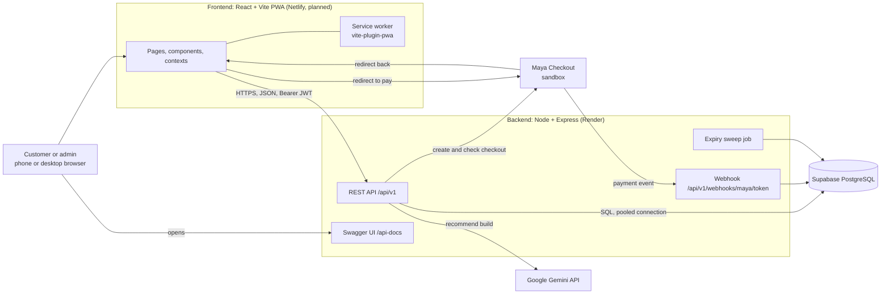
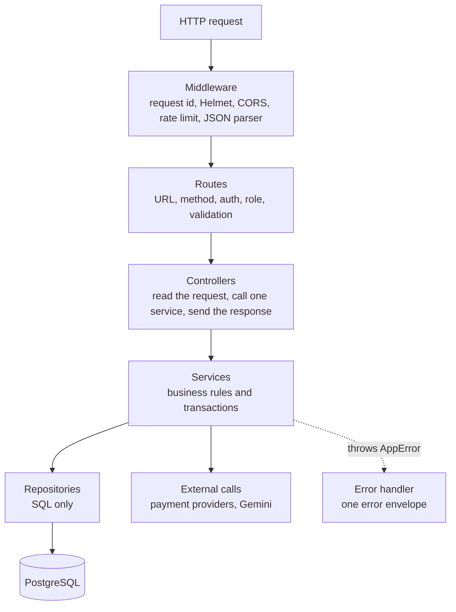

# Architecture

PC Parts Store is a React PWA (the customer-facing app) backed by a layered Node/Express REST API. The API stores data in Supabase PostgreSQL, takes payments through Maya (sandbox) and asks Google Gemini for build recommendations.

## System diagram

Reading the diagram:

- The browser only talks to the API. It never talks to the database, and it holds no secret keys.
- Maya is contacted in two ways. The customer's browser is redirected to Maya's page to pay. The server calls Maya to create the checkout and to double-check the result. Maya also calls the webhook.
- If the webhook never arrives, the customer's return to the site triggers `POST /orders/{id}/reconcile`, which asks Maya directly. See `docs/payment-integration.md`.
- Gemini is called only from the server, so the API key never reaches the browser.

## Backend layers

### What each layer may and may not do

| Layer | Folder | Does | Does not |
|---|---|---|---|
| Routes | `routes/` | Map a URL and method to a controller. Attach `auth`, `requireRole`, `validate(schema)` and rate limiters. | Contain logic. |
| Validators | `validators/` | Zod schemas for body, query and params. Most are `strict`, so unknown fields (a client-sent `price` or `total`) are rejected. | Touch the database. |
| Controllers | `controllers/` | Take validated input, call one service function, answer with `ok(res, data)`. | Contain business rules or SQL. |
| Services | `services/` | Business rules: pricing, coupons, stock reservation, the order workflow, payment settlement, AI recommendation, compatibility. Open transactions (`withTransaction`). | Know about `req` and `res`. |
| Repositories | `repositories/` | Run SQL. Take a `pool` or a transaction `client` as a parameter, so the same function works inside or outside a transaction. | Decide business rules. |
| Middleware | `middleware/` | Cross-cutting work: JWT check, role check, validation, request id, error handling. | Hold state. |
| Utils | `utils/` | `AppError`, `asyncHandler`, the response helper, `withTransaction`. | Depend on a feature. |
| Config | `config/` | The frozen `env` object, the business constants and the DB pool. | Read `process.env` anywhere else. |
| Jobs | `jobs/` | Background work (the expiry sweep). | Run inside a request. |

Rules that follow from this:

- A controller never calls a repository, and a repository never calls a service. Dependencies point one way: routes, controllers, services, repositories.
- Money and stock rules live only in services. The client sends no amounts, and every price comes from the database.
- Errors are thrown as `AppError(status, code, message, details)` and turned into `{ success: false, error: { code, message, details }, requestId }` in one place.

### Where the larger features live

| Feature | Main files |
|---|---|
| Checkout | `order.service.js`, `pricing.js`, `coupon.service.js`, `order.repository.js` |
| Order lifecycle | `orderWorkflow.js` (the transition table, stock reserve and release), `orderLifecycle.service.js` |
| Payments | `payment.service.js` (start a payment), `paymentSettlement.service.js` (settle a result), `services/payments/` (providers) |
| AI | `ai.service.js`, `aiFallback.js`, `buildCheck.service.js` |
| Compatibility | `compatibility.service.js`, `buildCheck.service.js` |
| Reviews | `review.service.js`, `review.repository.js` |
| Admin | `admin.product.service.js`, `admin.product.repository.js` |

### Payment providers

`services/payments/` holds `PaymentProvider.js` (the contract), `MayaProvider.js`, `MockProvider.js` and `paymentFactory.js`. The services never mention Maya. They ask the factory for the configured provider and call `createCheckoutSession`, `retrievePayment` and `verifyWebhook`. The webhook and the reconcile endpoint both finish in `settlePayment`, so a payment is handled the same way however the news arrives. The Mock provider is refused in production.

## Frontend structure

| Folder | Contents |
|---|---|
| `pages/` | One file per screen: Home, Products, ProductDetail, Cart, Checkout, Orders, OrderDetail, PaymentReturn, Login, Register, AiAssistant. `MockCheckout` is the development-only fake payment page. |
| `components/` | Shared pieces: Navbar, TopBar, BottomNav, ProductCard, AddToCartButton, CartLink, ProtectedRoute, OfflineBanner. |
| `context/` | App-wide state: `AuthContext` (user and token), `CartContext`, `NetworkStatusContext` (online or offline). |
| `hooks/` | `useDebounce` (search box), `useOnlineStatus`. |
| `api/` | `client.js` wraps `fetch` for the whole app (base URL, JSON, token header, error envelope). The other files group calls by feature (products, orders, AI) and include a mock gateway for development. |
| `utils/` | `format.js` (centavos to pesos) and `errorMessages.js` (API error codes to friendly text). |

Routing uses `react-router`. `ProtectedRoute` sends signed-in-only pages (cart, checkout, orders) to login. The app is mobile-first, with a bottom navigation bar, and is installable as a PWA through `vite-plugin-pwa`.

## Cross-cutting concerns

### Security

| Measure | Where |
|---|---|
| Passwords hashed with bcrypt, never returned | `auth.service.js` |
| JWT (HS256) with expiry, sent as a Bearer header | `middleware/auth.js` |
| Role check on every admin route | `middleware/requireRole.js` |
| Input validation with Zod, strict bodies | `validators/`, `middleware/validate.js` |
| Security headers | Helmet, applied globally in `app.js` |
| CORS allowlist, no wildcard | `app.js` |
| Rate limits on auth, AI, compatibility and review writes | `routes/*.routes.js` |
| Parameterised SQL only | `repositories/` |
| Webhook protected by a secret token in the URL, and the body is never trusted (the payment is re-fetched from Maya) | `webhook.routes.js`, `paymentSettlement.service.js` |
| Prompt-injection resistance: notes are untrusted data, and every product id Gemini returns is checked against the database | `ai.service.js` |
| Secrets only in environment variables, loaded once into a frozen object | `config/env.js` |

One deliberate exception: `/api-docs` turns off Helmet's Content-Security-Policy header, because Swagger UI needs inline scripts. It is registered before the global Helmet, so every other route keeps the full policy.

### Errors and logging

Every response uses the same envelope. Each request gets an id (`middleware/requestId.js`) that appears in error responses, so a user report can be matched to a request. Unknown routes return 404 `NOT_FOUND`, and unexpected errors return 500 `INTERNAL_ERROR` without leaking details.

### Background job

`jobs/expiry.job.js` is the expiry sweep. Every 60 seconds it expires two kinds of unpaid order: those whose stock hold has lapsed, and those whose payment failed and that sat idle for 30 minutes with no active hold. Expired orders give their stock back, so abandoned checkouts do not lock stock forever.

### Concurrency

- A checkout takes a per-user advisory lock and locks the cart row, so a double click or a parallel "add to cart" cannot interleave with it.
- Stock is reserved with one atomic `UPDATE ... WHERE stock >= n`.
- Order rows are locked before payment rows, always in that order, so concurrent settlement cannot deadlock.
- `POST /orders/{id}/pay` holds the order lock while it talks to the gateway, so two simultaneous clicks produce one checkout session.

## Deployment

| Part | Where | Notes |
|---|---|---|
| API | Render web service, root directory `backend` | Deploys on every push to `main`. Health check at `/api/v1/health`. The free instance sleeps when idle. `trust proxy` is set because Render sits behind a proxy. |
| Database | Supabase PostgreSQL | Connected through the pooler. |
| Frontend | Netlify | Planned. Not deployed yet. |
| Payments | Maya sandbox | Test cards only. No real money. |
| AI | Google Gemini | Key held only on the server. If Gemini fails, a keyword fallback answers. |

## Why it is built this way

1. **Layers make each rule easy to find and test.** The pricing rule is in one file, the SQL is in another, and the HTTP details are in a third.
2. **The database is the source of truth for money.** Totals, stock and statuses never come from the client.
3. **One settlement path for payments.** The webhook, the reconcile endpoint and the return page all end in `settlePayment`, so they cannot disagree.
4. **The gateway can be replaced.** Adding another provider means one new class and one line in the factory.
5. **Failure is expected.** A missed webhook, a double click, a failed payment and an AI outage each have a defined result.

## Related documents

- `docs/database.md`: tables, relationships and the ERD.
- `docs/business-rules.md`: the rules these layers implement.
- `/api-docs`: the full API reference.