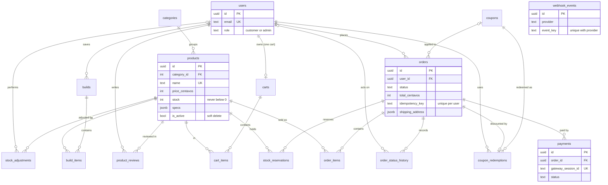

# Database design

PostgreSQL on Supabase. 17 tables in the `public` schema. This document was written from a dump of the live schema (`backend/scripts/dump-schema.js`), so it matches what is actually deployed.

To print the schema again: `cd backend && node --env-file=.env scripts/dump-schema.js`.

Limit: the repository does not hold a script that creates the whole schema. `backend/db/migrations` has only `002_payments_checkout_url.sql` and `003_product_reviews.sql`. The first tables were created outside the repository, and `dump-schema.js` prints a compact description, not runnable SQL. A fresh database cannot be rebuilt from the repository alone.

## Entity relationship diagram

Only key columns are shown. The full column list is in the table dictionary below.

`webhook_events` has no foreign key. It is a log of what the gateway sent, matched to payments through the gateway session id inside the payload.

## Table dictionary

Money columns are integers in centavos (100 centavos = PHP 1). Every `id` is a UUID generated by the database (`gen_random_uuid()`), except `categories.id`, which is a serial integer.

### Accounts

| Table | Columns | Rules |
|---|---|---|
| `users` | `id`, `email`, `password_hash`, `name`, `role` (default `customer`), `created_at` | `email` unique. `role` must be `customer` or `admin`. Passwords are stored only as bcrypt hashes. |

### Catalogue

| Table | Columns | Rules |
|---|---|---|
| `categories` | `id` (serial), `name` | `name` unique. |
| `products` | `id`, `category_id`, `name`, `description`, `price_centavos`, `stock`, `image_url` (nullable), `is_active` (default true), `specs` (jsonb, default `{}`), `created_at` | `name` unique. `price_centavos >= 0` and `stock >= 0` are CHECK constraints. `specs` holds the technical details the compatibility checker reads (socket, RAM type, wattage and so on). Products are hidden with `is_active = false`, never deleted. |
| `product_reviews` | `id`, `product_id`, `user_id`, `rating` (smallint), `comment` (nullable), `created_at`, `updated_at` | `rating` between 1 and 5. `comment` at most 1000 characters. One review per user per product (unique index). |
| `stock_adjustments` | `id`, `product_id`, `previous_stock`, `new_stock`, `reason`, `actor_id` (nullable), `created_at` | Audit trail of every manual stock change made by an admin. |

### Cart

| Table | Columns | Rules |
|---|---|---|
| `carts` | `id`, `user_id`, `created_at`, `updated_at` | `user_id` unique: one cart per user. |
| `cart_items` | `id`, `cart_id`, `product_id`, `quantity` | `quantity > 0`. A product appears once per cart (unique `cart_id, product_id`). |

### Orders and stock

| Table | Columns | Rules |
|---|---|---|
| `orders` | `id`, `user_id`, `status` (default `pending_payment`), `subtotal_centavos`, `discount_centavos`, `shipping_centavos`, `total_centavos`, `coupon_id` (nullable), `idempotency_key`, `shipping_address` (jsonb), `flag_reason` (nullable), `created_at`, `updated_at` | `status` is limited by a CHECK to the 8 workflow states. All four money columns are `>= 0`. `(user_id, idempotency_key)` is unique, which is what makes a repeated checkout return the same order. |
| `order_items` | `id`, `order_id`, `product_id`, `product_name`, `quantity`, `unit_price_centavos` | `quantity > 0`, price `>= 0`. The name and price are copied at purchase time, so later price changes or product renames never alter an old order. |
| `order_status_history` | `id`, `order_id`, `from_status` (nullable), `to_status`, `actor_id` (nullable), `note` (nullable), `created_at` | One row per status change. `actor_id` is empty when the system made the change (webhook, expiry sweep). |
| `stock_reservations` | `id`, `order_id`, `product_id`, `quantity`, `expires_at`, `released` (default false), `created_at` | `quantity > 0`. Stock held for an unpaid order until `expires_at` or until it is released. |

### Payments

| Table | Columns | Rules |
|---|---|---|
| `payments` | `id`, `order_id`, `provider`, `gateway_session_id`, `amount_centavos`, `currency` (default `PHP`), `status` (default `pending`), `checkout_url` (nullable), `created_at`, `updated_at` | `status` is one of `pending`, `paid`, `failed`, `expired`, `flagged`. `gateway_session_id` is unique. `amount_centavos >= 0`. At most one `pending` payment per order (partial unique index). |
| `webhook_events` | `id`, `provider`, `event_key`, `event_type` (nullable), `payload` (jsonb), `processed_at` (nullable), `created_at` | `(provider, event_key)` is unique, so the same gateway event can be stored only once. |

### Coupons

| Table | Columns | Rules |
|---|---|---|
| `coupons` | `id`, `code`, `discount_type`, `discount_value`, `min_spend_centavos` (default 0), `expires_at` (nullable), `usage_limit` (nullable), `per_user_limit` (default 1), `times_used` (default 0), `is_active` (default true) | `code` unique. `discount_type` is `percent` or `fixed`. `discount_value > 0`. `per_user_limit` is applied by application code; no database constraint covers it. |
| `coupon_redemptions` | `id`, `coupon_id`, `user_id`, `order_id`, `created_at` | `order_id` unique: an order uses at most one coupon. |

### Saved builds

| Table | Columns | Rules |
|---|---|---|
| `builds` | `id`, `user_id`, `name`, `created_at` | Not used by any current endpoint. |
| `build_items` | `id`, `build_id`, `product_id` | Unique `(build_id, product_id)`. Not used by any current endpoint. |

## Foreign keys and delete rules

**ON DELETE CASCADE** (child rows are removed with the parent):

| Child | Parent |
|---|---|
| `carts` | `users` |
| `cart_items` | `carts` |
| `builds` | `users` |
| `build_items` | `builds` |
| `product_reviews` | `users` and `products` |
| `order_items` | `orders` |
| `order_status_history` | `orders` |
| `stock_reservations` | `orders` |

**No action** (the database refuses to delete the parent while children exist):

| Child | Parent |
|---|---|
| `orders` | `users`, `coupons` |
| `payments` | `orders` |
| `coupon_redemptions` | `users`, `coupons`, `orders` |
| `order_items` | `products` |
| `cart_items`, `build_items`, `stock_reservations`, `stock_adjustments` | `products` |
| `stock_adjustments`, `order_status_history` (`actor_id`) | `users` |
| `products` | `categories` |

The split is deliberate. Things that only make sense while their owner exists (a cart, its lines, an order's own items and history) cascade. Financial and audit records (orders, payments, redemptions, stock adjustments) cannot be wiped by deleting a user or a product. That is also why products are soft-deleted: a product that appears in an old order can never be removed. The API has no endpoint that deletes users.

## Indexes

Primary keys and unique constraints create their own indexes. These are the extra ones:

| Index | Purpose |
|---|---|
| `orders (user_id)` | "My orders" list |
| `orders (status)` | Filtering by status |
| `order_items (order_id)` | Loading an order's lines |
| `payments (order_id)` | Finding the payments of an order |
| `payments (order_id) WHERE status = 'pending'` (unique) | Only one open payment per order, even with two simultaneous "Pay" requests |
| `products (category_id)` | Category filter |
| `products (is_active)` | Catalogue only shows active products |
| `product_reviews (user_id, product_id)` (unique) | One review per user per product |
| `product_reviews (product_id, created_at DESC)` | Newest reviews of a product first |
| `stock_reservations (expires_at) WHERE released = false` | The expiry sweep only scans holds that are still active |

Not indexed: `order_status_history (order_id)`, `stock_adjustments (product_id)` and `orders (coupon_id)`. These tables are small for this project, so it makes no measurable difference. On a large production database they would get indexes.

## Design decisions

1. **Money is an integer in centavos.** Floating-point numbers cannot store 0.1 exactly, and rounding errors in a shop add up. Integers are exact. The API sends centavos and the frontend formats them as pesos.
2. **The database enforces the rules, not only the code.** CHECK constraints stop negative stock, negative prices, invalid statuses and invalid ratings, even if a bug or a direct SQL change tries them.
3. **Stock changes are atomic.** Reserving stock is a single `UPDATE products SET stock = stock - n WHERE id = ... AND stock >= n AND is_active = true`. If no row is updated, there was not enough stock. Two customers buying the last unit cannot both succeed, and the `stock >= 0` CHECK is a second safety net.
4. **Orders keep a snapshot.** `order_items` stores the product name and unit price at purchase time, and `orders` stores the shipping address as JSON. An order never changes when the catalogue does.
5. **Checkout is idempotent.** `UNIQUE (user_id, idempotency_key)` means a double-clicked or retried checkout returns the original order instead of creating a second one.
6. **Payments are deduplicated at three levels.** Unique `gateway_session_id` (one row per gateway session), the partial unique index (one open payment per order), and `UNIQUE (provider, event_key)` on `webhook_events` (one row per gateway event).
7. **Every status change is recorded.** `order_status_history` gives a full timeline of who changed what and when, and an optional note, for example why a payment was flagged.
8. **Flexible specs, strict core.** Product specs differ by category (a CPU has a socket, a PSU has wattage), so they are stored in a `jsonb` column. Everything that must be consistent (prices, stock, status) is in normal typed columns.
9. **Soft delete for products.** `is_active = false` hides a product from customers but keeps it for old orders and reviews.

## Related documents

- `docs/business-rules.md` explains the rules that use these tables (stock reservation, coupons, order lifecycle).
- `/api-docs` shows the API response shapes built from these tables.