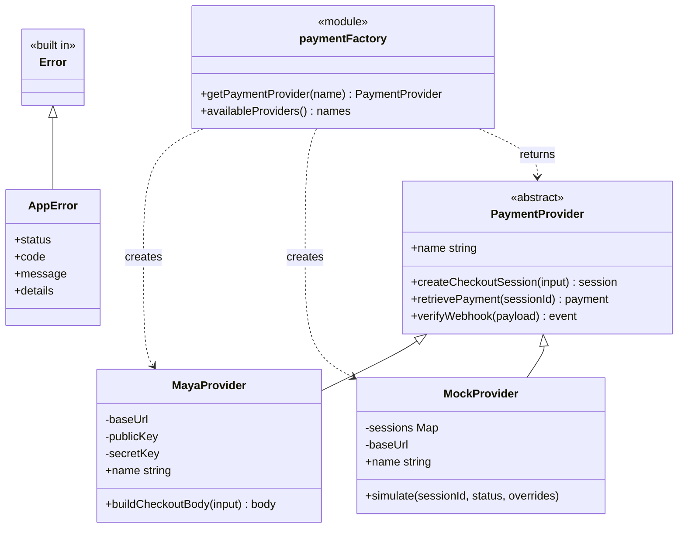

# Design Patterns and OOP

This document lists the design patterns and object-oriented techniques used in the backend, and where each one lives in the code. Every pattern here points at a real file. Nothing is listed that the code does not do.

Most of the backend is plain functions grouped in modules, because that suits Express. Classes are used where they pay off: a family of interchangeable payment gateways, and one custom error type.

## Class model

`paymentFactory` is a module of functions, not a class. It is drawn as a box only to show who creates what.

## Patterns at a glance

| Pattern | Where | What it solves |
|---|---|---|
| Strategy | `services/payments/PaymentProvider.js` and its subclasses | Payment code works with Maya or the mock without knowing which. |
| Factory | `services/payments/paymentFactory.js` | One place decides which provider to build, and refuses unsafe choices. |
| Adapter | `MayaProvider` | Turns Maya's own response shapes into the app's normalised shapes. |
| State machine | `services/orderWorkflow.js` (`TRANSITIONS`) | An order can only move along allowed paths. |
| Unit of work | `utils/transaction.js` (`withTransaction`) | A group of database changes succeeds or fails as one. |
| Middleware chain | `middleware/` and `routes/` | Each request passes through small, single-purpose steps. |
| Higher-order function | `asyncHandler`, `validate`, `requireRole` | Reusable behaviour wrapped around handlers. |
| Repository | `repositories/` | SQL stays out of services and controllers. |

## Strategy: interchangeable payment providers

`PaymentProvider` defines the contract every gateway must follow:

| Method | Returns |
|---|---|
| `createCheckoutSession(input)` | `{ sessionId, checkoutUrl, amountCentavos, currency }` |
| `retrievePayment(sessionId)` | `{ sessionId, status, amountCentavos, currency, reference }`, with status `paid`, `failed`, `cancelled`, `expired` or `pending` |
| `verifyWebhook(payload)` | `{ eventKey, eventType, sessionId }`, or `null` for an unknown event |

`MayaProvider` talks to the real Maya sandbox. `MockProvider` is a fake gateway kept in memory for development and automated tests. The payment services (`payment.service.js`, `paymentSettlement.service.js`) only call the three methods above. They never check which provider they have, so adding a third gateway means one new subclass and one line in the factory. No payment logic changes.

The provider name is stored on each `payments` row, so a later reconcile or webhook uses the same provider that created the session.

## Factory: choosing and guarding the provider

`getPaymentProvider(name)` in `paymentFactory.js`:

- Looks the name up in a `builders` map (`maya`, `mock`). The name defaults to `PAYMENT_PROVIDER`.
- Throws on an unknown name.
- **Refuses the mock when `NODE_ENV=production`**, so a misconfigured deploy cannot ship a fake gateway.
- Builds the provider the first time it is asked for and keeps it in a module-level `Map`, so there is one instance per provider name.

That cache is a convenience, not a strict Singleton: nothing stops code from building a provider another way. It exists so `MockProvider` keeps its in-memory sessions between calls. This is also why mock sessions are lost if the server restarts.

`availableProviders()` lists the names the factory can build.

## Adapter: normalising Maya

Maya's responses do not look like the app's contract, so `MayaProvider` adapts them:

- Amounts: Maya returns the total at `totalAmount.amount` as a string in pesos. The provider converts it to integer centavos.
- Statuses: a strict map. Only an exact `PAYMENT_SUCCESS` is `paid`. `PAYMENT_FAILED` is `failed`, `PAYMENT_EXPIRED` is `expired`, anything containing `CANCEL` is `cancelled`, and everything else stays `pending`.
- Requests: `buildCheckoutBody` is a pure function that builds Maya's request body and checks that the item lines add up to the subtotal and that subtotal minus discount plus shipping equals the total. If not, it raises 500 `PAYMENT_AMOUNT_MISMATCH` before anything is sent.

The details are in `docs/payment-integration.md`.

## State machine: order status

`orderWorkflow.js` holds the allowed moves as data:

| From | May move to |
|---|---|
| `pending_payment` | `paid`, `cancelled`, `expired`, `payment_flagged` |
| `payment_flagged` | `paid`, `cancelled` |
| `paid` | `processing` |
| `processing` | `shipped` |
| `shipped` | `delivered` |
| `cancelled`, `expired`, `delivered` | nothing (final) |

- `canTransition(from, to)` answers yes or no.
- `assertTransition(from, to)` throws `AppError` 409 `ILLEGAL_TRANSITION` with `{ from, to }`.
- `transition(client, order, to, { actorId, note })` checks the move, updates the status and writes an `order_status_history` row. `actorId = null` means the system did it, for example the expiry sweep.

Every status change goes through this one function, so the history is complete and no code path can skip the rules. Adding a status means editing one table.

`lockOrder` takes `SELECT ... FOR UPDATE` on the order row, so two actions on the same order (a cancel and a webhook, say) run one after the other.

## Unit of work: transactions

`withTransaction(fn)` opens a connection, runs `BEGIN`, calls `fn(client)`, then `COMMIT`. On any error it rolls back and rethrows, and it always releases the connection. Services pass the `client` down to repository functions, so everything in one business action shares one transaction.

`reserveOrderStock` adds a **savepoint** inside the transaction. It takes a hold for every item of an order, and if one item is out of stock it rolls back to the savepoint, undoing the items already taken, and returns `{ ok: false, productName }`. The result is all or nothing.

## Middleware chain and higher-order functions

A request passes through small steps, each doing one job: request id, security headers, CORS, JSON parsing, rate limit, authentication, role check, validation, then the controller.

Three of them are higher-order functions, meaning a function that takes or returns a function:

- `asyncHandler(fn)` wraps an async controller so a rejected promise reaches Express's error handler. Express 4 does not do this by itself.
- `validate(schema, source)` returns middleware that checks `req.body`, `req.query` or `req.params` against a Zod schema. A failure becomes 422 `VALIDATION_ERROR` with a list of `{ field, message }`. On success it replaces the input with the cleaned values, so the controller never sees unknown fields.
- `requireRole(...roles)` returns middleware that gives 401 with no user and 403 for the wrong role. Admin routes use `router.use(auth, requireRole('admin'))`.

## Repository layer

Database access sits in `repositories/`, and services call those functions instead of writing SQL. For example `order.repository.js` has `reserveStock`, `insertOrder`, `insertItem`, `insertReservation`, `insertHistory` and `findOrder`. `reserveStock` is one atomic `UPDATE ... WHERE stock >= $1 AND is_active = true`, which is what stops two buyers taking the last unit. The layer rules are in `docs/architecture.md`.

## OOP techniques

| Technique | Where | How |
|---|---|---|
| Abstraction | `PaymentProvider` | The constructor throws if `new.target === PaymentProvider`, so the base class cannot be instantiated. |
| Abstract methods | `PaymentProvider` | `name`, `createCheckoutSession`, `retrievePayment` and `verifyWebhook` throw a `TypeError` naming the subclass if not overridden. |
| Inheritance | `MayaProvider`, `MockProvider` | Both `extend PaymentProvider` and call `super()`. |
| Polymorphism | Payment services | The same three calls behave differently depending on the provider object. |
| Encapsulation | `MockProvider`, `MayaProvider` | Private `#` fields (`#sessions`, `#baseUrl`, and the Maya keys) cannot be read or changed from outside. The secret key never leaves the object. |
| Fail fast | `MayaProvider` constructor | It throws if a key is missing, so a bad config shows at startup instead of at the first payment. |
| Custom error type | `utils/errors.js` | `AppError extends Error` and adds `status`, `code` and `details`. The error handler turns it into the standard error envelope. |

`MockProvider.simulate(sessionId, status, overrides)` is a test helper and is not part of the abstract contract. It lets the test scripts move a fake payment to `paid` or `failed`.

## Documented refactor: extracting `releaseStock`

**Problem.** A failed or cancelled payment has to give the reserved stock back, but the order must stay `pending_payment` and keep its coupon, so the customer can try again. `releaseHold` did more than that: it also expired the payment, released stock and freed the coupon. That is right for a cancelled or expired order, but wrong for a failed payment.

**Change.** The stock-release SQL was pulled out into its own function, `releaseStock(client, orderId)`:

- It marks the order's unreleased reservations as released and adds the quantities back to `products.stock`, in one statement.
- It sets `orders.updated_at = now()`.
- It is safe to call twice, because reservations already released are skipped.

`releaseHold` now calls `releaseStock` and then adds the order-closing steps: it marks any pending payment `expired` and deletes the coupon redemption, decrementing `coupons.times_used`.

| Situation | Function used | Result |
|---|---|---|
| Payment failed or cancelled | `releaseStock` | Stock returns, order stays `pending_payment`, coupon is kept. |
| Order cancelled or expired | `releaseHold` | Stock returns, pending payment marked `expired`, coupon freed. |

**Why `updated_at` matters.** `releaseStock` touches `updated_at` on purpose. The expiry sweep treats an order as abandoned when it has no active hold, no pending payment and its `updated_at` is older than `RESERVATION_MINUTES` (30). Releasing stock restarts that 30-minute clock, so the customer gets a full window to retry before the sweep closes the order.

**Result.** No behaviour changed for cancellation and expiry. Failed payments gained the correct, gentler behaviour, and the stock logic exists in one place instead of two.

## Limits

- JavaScript has no interfaces or compile-time abstract classes. "Abstract" is enforced at runtime by the `new.target` check and the throwing methods.
- Only the payment providers and `AppError` are classes. Services, repositories and controllers are plain functions, which is the usual style for Express.
- There is no dependency-injection container. The factory is the single place that wires providers.
