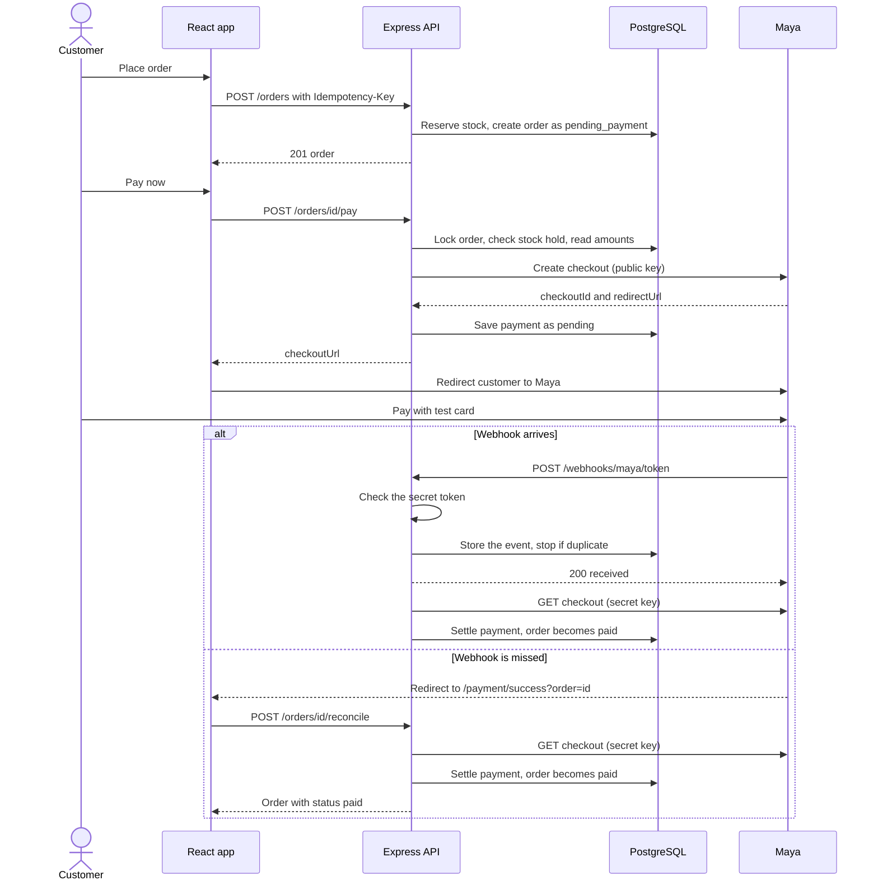

# Payment integration

Real payments go through the **Maya Checkout sandbox** (`https://pg-sandbox.paymaya.com`). No real money moves: only Maya's test cards work. A **Mock provider** replaces Maya in development and in the automated payment scripts, and it is refused in production.

## Checkout flow

The two branches are not exclusive. Usually the webhook and the customer's return both happen. Both end in the same function, `settlePayment`, which is safe to run any number of times for the same payment, so the order is paid exactly once.

### Step by step

1. **Checkout** (`POST /orders`) creates the order as `pending_payment` and reserves the stock for 30 minutes. See `docs/business-rules.md`.
2. **Start payment** (`POST /orders/{id}/pay`, `payment.service.js`) locks the order row, checks the stock hold and asks the provider for a checkout session. Every amount comes from the database. The client sends none.
   - If a session is already open for the order, the same `checkoutUrl` is returned (`reused: true`). The order lock is held while the server talks to Maya, so two quick clicks on "Pay now" produce one session.
   - If an earlier failed payment released the stock, it is reserved again here. If it is gone, the answer is 409 `INSUFFICIENT_STOCK`.
3. **The customer pays on Maya's page.** Maya then redirects the browser back to the frontend:

   | Outcome on Maya | Redirect |
   |---|---|
   | Success | `/payment/success?order={id}` |
   | Failure | `/payment/cancelled?order={id}&reason=failed` |
   | Cancel | `/payment/cancelled?order={id}` |

4. **The server confirms with Maya.** It never trusts the webhook body or the redirect. `settlePayment` asks Maya for the checkout with a server-to-server call and decides from that answer.

## Provider design

`services/payments/` contains:

| File | Role |
|---|---|
| `PaymentProvider.js` | Abstract base class (the contract). It throws if instantiated directly or if a method is missing. |
| `MayaProvider.js` | The real gateway. |
| `MockProvider.js` | Fake gateway for development and tests. |
| `paymentFactory.js` | Returns one cached instance of the configured provider. Refuses the mock in production. |

The contract has three methods. Services depend only on these, never on Maya:

| Method | Returns |
|---|---|
| `createCheckoutSession(input)` | `{ sessionId, checkoutUrl, amountCentavos, currency }` |
| `retrievePayment(sessionId)` | `{ sessionId, status, amountCentavos, currency, reference }`, where status is `paid`, `failed`, `cancelled`, `expired` or `pending` |
| `verifyWebhook(payload)` | `{ eventKey, eventType, sessionId }`, or `null` for an event we do not understand |

### How `MayaProvider` talks to Maya

- **Create:** `POST /checkout/v1/checkouts`, authenticated with the **public** key (HTTP Basic, key as the username). Maya answers with `checkoutId` and `redirectUrl`.
- **Retrieve:** `GET /checkout/v1/checkouts/{id}`, authenticated with the **secret** key.
- **Amounts:** the database holds centavos and Maya expects pesos, so values are converted at the edge (`toPesos`, `toCentavos`).
- **Self-check before sending:** `buildCheckoutBody` re-adds the lines and rejects the order with 500 `PAYMENT_AMOUNT_MISMATCH` if the lines do not add up to the subtotal, or if subtotal minus discount plus shipping does not equal the total. Maya is never sent an inconsistent order.
- **Timeout:** 10 seconds per call. Gateway errors become 502 `PAYMENT_GATEWAY_ERROR`. For a rejection, the error details carry Maya's status, code, message and parameters, so a bad request can be diagnosed without reading server logs.
- **Status mapping is strict.** Only an exact `PAYMENT_SUCCESS` counts as paid. `PAYMENT_FAILED` is failed, `PAYMENT_EXPIRED` is expired, anything containing `CANCEL` is cancelled, and every other value stays `pending`. An unknown value can never mark an order paid.
- **Amount read:** the real Maya response puts the total at `totalAmount.amount` as a string such as `"2100"`. See "A bug found with the real sandbox" below.

## Webhook

`POST /api/v1/webhooks/maya/{token}`

### Security model

The webhook is protected by a **secret token in the URL** (`MAYA_WEBHOOK_TOKEN`), **not by a signature header**. Two layers keep a forged request harmless:

1. **The token.** Both sides are hashed with SHA-256 and compared with `timingSafeEqual`, so the check takes the same time however close a guess is. If no token is configured, the webhook is closed and every request gets 401. A wrong token gets 401 `WEBHOOK_UNAUTHORIZED` (covered by a Jest test, including a 500-character token).
2. **The body is never believed.** The only thing taken from the body is a session id. `settlePayment` looks that id up in our own `payments` table (an unknown id does nothing) and then fetches the real payment status from Maya with the secret key. Someone who knew the URL could at most make the server ask Maya a question.

The route is registered before `express.json` and uses `express.raw`, so the body arrives untouched (limit 100 kb).

### Handling

| Step | Result |
|---|---|
| Token wrong | 401 `WEBHOOK_UNAUTHORIZED` |
| Body is not JSON | 400 `INVALID_JSON` |
| Event has no `id` and `paymentStatus` | 200 `{ received: true, ignored: true }`. A 2xx stops the gateway from retrying an event we do not use. |
| Event already stored | 200 `{ received: true, duplicate: true }`. No second processing. |
| New event | Stored in `webhook_events`, answered with 200 at once, then settled in the background (`setImmediate`). The row is marked processed when settlement finishes. |

The event key is `{id}:{paymentStatus}`, and `(provider, event_key)` is unique in the database, so a repeated delivery of the same event is stored once.

If background settlement throws, the error is logged and the event stays unprocessed. A retry of that same event would be treated as a duplicate, so it would not run again. That is acceptable because the customer's return to the site, or a later `reconcile`, settles the payment through the same code. This is exactly the missed-webhook path.

## Settlement: what a payment result does to an order

`settlePayment` (`paymentSettlement.service.js`) is the only place where a gateway result changes an order. It locks the order row first and the payment row second, always in that order, so two settlements cannot deadlock.

| Gateway says | Checks | Payment | Order |
|---|---|---|---|
| Unknown session id | | nothing | nothing |
| Already settled earlier | payment is `paid` or `flagged` | unchanged | unchanged |
| Still pending | | unchanged | unchanged |
| Paid | amount, currency and reference match, order is still open | `paid` | `paid` |
| Paid, after the stock hold was released | as above, and the stock is taken again | `paid` | `paid` |
| Paid, but something is wrong | amount, currency or reference differ, the order was already closed, or the stock is gone | `flagged` | `payment_flagged`, with the reason saved in `flag_reason` |
| Failed or cancelled | | `failed` | stays `pending_payment`. Stock goes back on the shelf unless another session is open. "Pay now" reserves it again. |
| Expired | | `expired` | `expired`, hold released |

**Why flag instead of reject.** When money may have arrived, silently ignoring it is the worst result. The order is marked `payment_flagged`, the reason is recorded in the status history, and a person decides on a refund or a restock. The customer sees "Payment under review" and is told not to pay again.

## Missed-webhook path

The webhook can fail to arrive: the server was asleep (the free Render instance sleeps), the URL is not registered, or the network dropped it. The design assumes this will happen.

- After paying, Maya redirects the browser to `/payment/success?order={id}`.
- `PaymentReturn.jsx` immediately calls `POST /orders/{id}/reconcile`. The server asks Maya about every open payment of that order and settles each one with `settlePayment`.
- The heading shown to the customer depends on the order status the server returns (paid, under review, not confirmed yet, closed), never on which URL the browser landed on. Opening `/payment/success` by hand cannot show a false "paid".
- If the answer is still `pending_payment`, the page offers "Check again". If the customer came back from a cancelled payment, it offers "Pay again".
- The same endpoint is public API (`/api-docs`) and is safe to call repeatedly.

This path was verified against the real sandbox: order `#19265337` (PHP 9,145.00) ended as **Paid** through `/payment/success` calling reconcile, with no webhook involved.

## A bug found with the real sandbox

The first real payment ended as "Payment under review". The code read the total from `totalAmount.value`, but Maya's response puts it at `totalAmount.amount`, as a string. The amount therefore looked missing and the safety check flagged the payment, as designed. The fix is the `#readAmount` helper, which reads `totalAmount.amount` first and returns `null` when no usable number is found, so the payment is flagged and never compared against `NaN`. The old order `#5B395A8C` stays as a live example of the flagged state.

The lesson: a response shape taken from documentation or memory is a guess. The shape was confirmed with a real call.

## Expiry sweep

`jobs/expiry.job.js` calls `expireStaleOrders()` (from `orderLifecycle.service.js`) every 60 seconds, with the first run 5 seconds after the server starts. It does not run during tests. This stops abandoned checkouts from holding stock forever.

Each pass looks for two kinds of order, both still `pending_payment` (up to 100 of each per pass):

- **Lapsed hold.** An unreleased stock reservation whose `expires_at` has passed. History note: "Payment window ended".
- **Abandoned after a failed payment.** No active hold, no pending payment, and the order has not been updated for `RESERVATION_MINUTES` (30). History note: "Payment failed and was not retried".

Each order is then locked and re-checked inside a transaction. If a retry took a fresh hold in the meantime, the order is skipped. Otherwise it moves to `expired` and `releaseHold` gives the stock back. One order failing is logged and does not stop the others. The sweep is covered by `scripts/expiry-sweep-test.js` (4 checks).

## Configuration

| Variable | Purpose |
|---|---|
| `PAYMENT_PROVIDER` | `maya` or `mock`. The mock is refused when `NODE_ENV=production`. |
| `MAYA_PUBLIC_KEY` | Sandbox public key. Used to create checkouts. |
| `MAYA_SECRET_KEY` | Sandbox secret key. Used to retrieve checkouts. Server only. |
| `MAYA_WEBHOOK_TOKEN` | Secret path token for the webhook. |
| `FRONTEND_URL` | Where Maya sends the customer back. |
| `MAYA_BASE_URL` | Maya API base URL. The sandbox is `https://pg-sandbox.paymaya.com`. |
| `API_PUBLIC_URL` | This API's public base URL. It is read into `env.js` as `apiPublicUrl` (default `http://localhost:<port>`), but no code uses it yet. |

No key is ever sent to the browser, and no key is in the repository (`.env` is ignored, and `.env.example` holds placeholders only).

The webhook URL to register in the Maya sandbox is:

`https://pc-parts-api-kik5.onrender.com/api/v1/webhooks/maya/<MAYA_WEBHOOK_TOKEN>`

## Testing and demo

### Maya sandbox test cards

| Card | Number | Expiry | CVV | Notes |
|---|---|---|---|---|
| Visa | 4123 4501 3100 0508 | 12/2030 | 111 | Normal successful payment |
| Mastercard | 5123 4567 8901 2346 | 12/2030 | 111 | Backup card |
| Visa with 3D Secure | 4123 4501 3100 1381 | 12/2030 | 123 | The 3DS page asks for the password `mctest1` |

### Demo script

1. Add parts to the cart and check out, then press **Pay now**. The browser goes to Maya's sandbox page.
2. Pay with the Visa test card. Maya redirects to `/payment/success`, the page verifies with the server, and the order shows **Paid** with a history entry "Payment confirmed by maya (reconcile)".
3. For the closed path, press **Pay now** on another order and cancel on Maya's page. The order stays `pending_payment` with the stock released, and **Pay again** appears.
4. Open the flagged order `#5B395A8C` to show the review state and its reason.

### Automated

| Check | What it proves |
|---|---|
| `webhook.test.js` (Jest) | A wrong token and an oversized token are rejected with 401 `WEBHOOK_UNAUTHORIZED`. |
| `scripts/webhook-test.js` (14 checks, mock provider) | Duplicate events, replays, amount mismatch and the other settlement paths. |
| `scripts/expiry-sweep-test.js` (4 checks, mock provider) | The sweep expires lapsed orders and releases stock. |
| `scripts/pay-test.js`, `scripts/payment-smoke.js` | Start payment and the provider contract. |
| Postman, "Payments" folder | Start payment, reuse of the open session, reconcile of an unpaid order, and the wrong webhook token. |

The `scripts/` checks assert `PAYMENT_PROVIDER=mock`. Run them with the mock configured, then switch back to `maya`.

## Known limitations

- **The Maya webhook is not registered yet.** Until it is, every real payment settles through the reconcile path. `verifyWebhook` reads `id` and `paymentStatus` from the body, and this has not yet been checked against a payload sent by Maya itself.
- **A checkout that expires at Maya** with no useful `paymentStatus` stays `pending` in our mapping, so the payment row is not marked `expired` straight away. The order is closed by the expiry sweep once its hold lapses, and that step (`releaseHold`) also marks the still-pending payment `expired` and gives the stock back, so nothing stays stuck.
- **Failed and cancelled both map to `failed`** in the `payments` table, because its status check does not allow `cancelled`.
- **No refunds.** A flagged payment needs a manual decision outside the app.
- The sandbox has been exercised with successful payments. The failed-card and 3DS paths follow the same code but were not run against Maya.